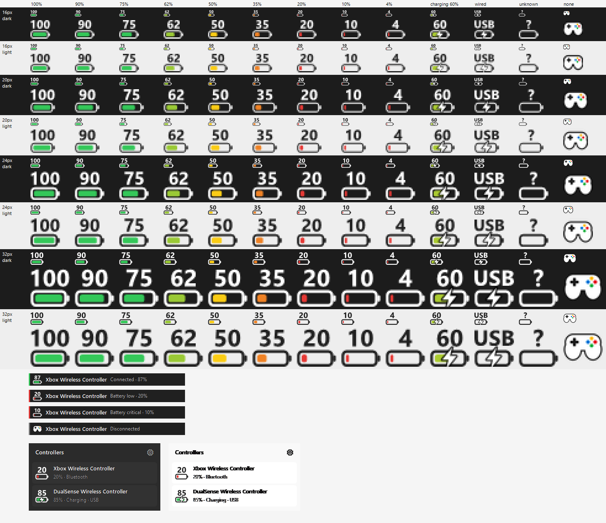

  

<h1 align="center">ControllerHP</h1>

Battery levels for game controllers and Bluetooth mice, keyboards and headsets, in the Windows taskbar.

  
  
  
  

  <a href="#features">Features</a> · <a href="#install">Install</a> · <a href="docs/wiki/README.md">Wiki</a> · <a href="#help">Help</a> · <a href="#contributing">Contributing</a> · <a href="#license">License</a>

## Features

- **An icon in the taskbar for each kind of device**, a controller, mouse, keyboard or headset, with a battery bar that turns from green to red, and a bolt while charging. Hover for the exact percentage.
- **Pop-ups** when a device connects or disconnects, and when its battery runs low (20% and 10% by default, or levels of its own), with a sound if you like.
- **One icon for several devices**, showing whichever is lowest, or one icon each if you prefer.
- **A panel on left-click** listing every device with its charge and connection.
- **A Devices page** with each device's battery history, average drain, time left, play time and a battery health estimate, its own warning levels, and a way to rename devices or remove ones you no longer use.
- **Choose what to watch:** turn off whole kinds of device, such as keyboards, in Settings.
- **Shares battery levels with other apps** if you turn it on, such as Rainmeter skins or scripts, through a file on your PC.
- **Follows Windows' light or dark mode**, and runs quietly: a check every 30 seconds, nothing sent anywhere.

## Documentation

This page covers the basics. The **[wiki](docs/wiki/README.md)** has the rest:
- [setting up](docs/wiki/getting-started.md) and what [each setting](docs/wiki/using-controllerhp.md) does;
- how the [battery stats and health](docs/wiki/devices.md) are worked out, and what's stored on your PC;
- what each [device and connection](docs/wiki/supported-devices.md) can report;
- [fixes for common problems](docs/wiki/troubleshooting.md).

If something isn't working, Troubleshooting is the place to start.

## Install

1. Download a zip from [Releases](https://github.com/veloxity343/ControllerHP/releases/latest):

   | Download | Size | Needs |
   |---|---|---|
   | `ControllerHP-x.y.z-win-x64.zip` | ~6 MB | [.NET 8 Desktop Runtime](https://dotnet.microsoft.com/download/dotnet/8.0) (Windows offers it if it's missing) |
   | `ControllerHP-x.y.z-win-x64-standalone.zip` | ~72 MB | Nothing |

2. Extract `ControllerHP.exe` somewhere permanent, such as `%LOCALAPPDATA%\Programs\ControllerHP`, and run it.
3. If Windows shows **"Windows protected your PC"**, choose **More info → Run anyway**. ControllerHP isn't code-signed, so Windows warns about it until it's widely downloaded.

Requires Windows 10 version 1809 or later. [Getting started](docs/wiki/getting-started.md) covers keeping the icon visible, starting with Windows, updating and uninstalling. See [CHANGELOG.md](CHANGELOG.md) for what's new in each version.

## Supported devices

| Controller | Bluetooth | USB | Xbox Wireless Adapter |
|---|---|---|---|
| Xbox One / Series | **Tested** | Untested | Untested |
| DualSense | **Tested** | Untested | — |
| DualSense Edge | Likely | Untested | — |
| DualShock 4 | Untested | Untested | — |

**Tested** means seen working on real hardware. **Likely** means not tried yet, but it uses the same code as a tested one. **Untested** means written from the device's documented format but not yet tried. Have one that's Likely or Untested? [Tell us how it goes](https://github.com/veloxity343/ControllerHP/discussions).

PlayStation controllers report battery in 10% steps.

**Bluetooth mice, keyboards and headsets** work when Windows itself shows their battery, under Settings → Bluetooth & devices. Tested: a Bluetooth keyboard.

**Logitech mice, keyboards and headsets** on a Unifying, Bolt or Lightspeed receiver are read too. Tested: a G Pro Wireless. Other makers' USB receivers (dongles) aren't supported yet.

See [Supported devices](docs/wiki/supported-devices.md) for what each device and connection can report, and the known limitations.

## Help

- **Something not working?** Start with [Troubleshooting](docs/wiki/troubleshooting.md).
- **Questions** go in [Discussions](https://github.com/veloxity343/ControllerHP/discussions).
- **Bugs and ideas** go in [Issues](https://github.com/veloxity343/ControllerHP/issues/new/choose), where a short form asks for what's needed to help.
- **Security problems:** please report them privately, as described in [SECURITY.md](SECURITY.md).

## Contributing

Bug reports, results from devices nobody has tested yet, and pull requests are all welcome. See [CONTRIBUTING.md](CONTRIBUTING.md) and the [developer docs](docs/dev/README.md). Everyone taking part is expected to follow the [Code of Conduct](CODE_OF_CONDUCT.md).

Looking for something to work on? [Help wanted](docs/dev/help-wanted.md) lists open ideas: more controllers (Switch Pro, Joy-Con, 8BitDo), devices on USB receivers, Linux and macOS versions, new features and automated tests.

## License

[MIT](LICENSE)
