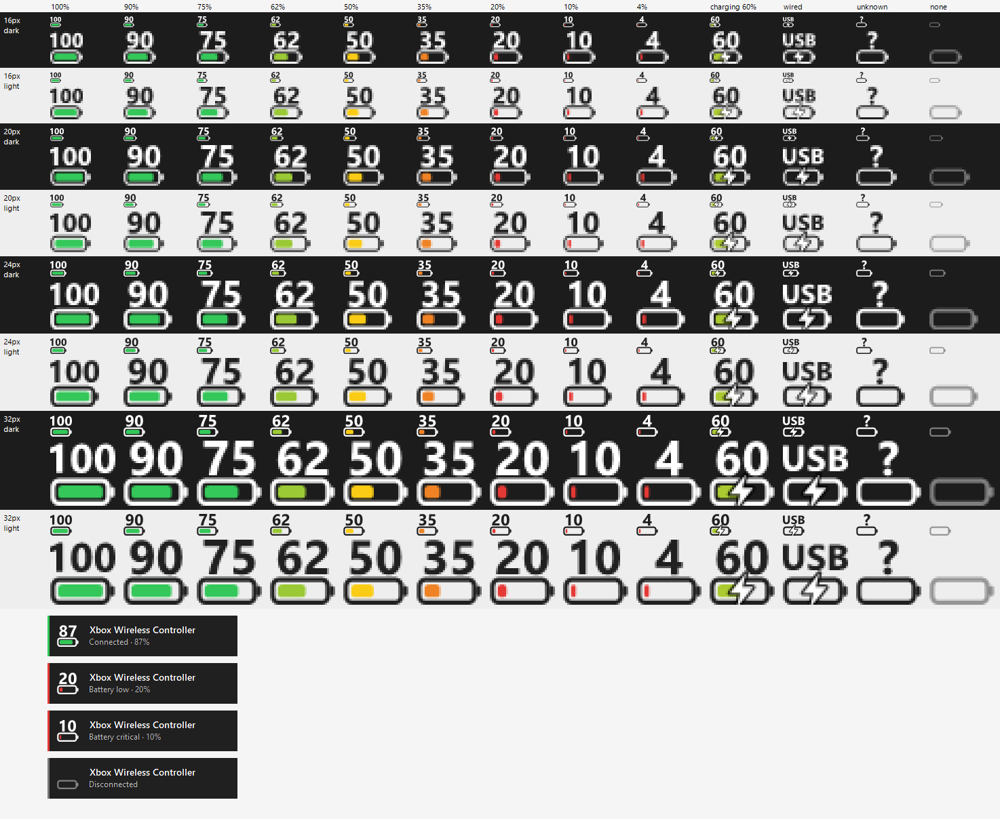

# ControllerHP

Your controller's hit points, in the Windows taskbar.

ControllerHP puts a battery meter in the notification area for your game controllers: the percentage on top, a meter underneath whose fill and colour track the charge (green → yellow → red), and a bolt through it while charging. Slim pop-ups in the top-right corner tell you when a controller connects or disconnects, and when its battery drops to 20% and 10%. Right-click the tray icon to move them to another corner or turn off the connect/disconnect ones.

With several controllers connected, one icon shows the controller with the lowest battery (charging ones go last), and hovering lists the rest. Right-click → **Tray icons** to show up to four, or one per controller.



## Install

Download the latest zip from [Releases](../../releases), extract `ControllerHP.exe` anywhere (e.g. `%LOCALAPPDATA%\Programs\ControllerHP`), and run it. Right-click the tray icon and tick **Start with Windows** to keep it running.

| Download | Size | Needs |
|---|---|---|
| `ControllerHP-x.y.z-win-x64.zip` | ~6 MB | [.NET 8 Desktop Runtime](https://dotnet.microsoft.com/download/dotnet/8.0) (Windows offers the download link if it's missing) |
| `ControllerHP-x.y.z-win-x64-standalone.zip` | ~72 MB | Nothing |

Requires Windows 10 1809 or later.

## Supported controllers

| Controller | Connection | Battery | Charging |
|---|---|---|---|
| Xbox One / Series | Bluetooth | Exact % | Inferred from the % rising (a minute or two after plugging in) |
| Xbox One / Series | USB, Xbox Wireless Adapter | Exact % or 4 levels | Yes |
| DualSense / DualSense Edge | USB, Bluetooth | 10% steps | Yes |
| DualShock 4 | USB, Bluetooth | 10% steps | Yes |

### Known limitations

- Pop-ups can't appear over games running in exclusive fullscreen (borderless and windowed are fine).
- Over Bluetooth, Windows exposes no charging flag for Xbox controllers, so charging is inferred: the bolt appears at the first percentage rise and clears at 100% or after 5 minutes without one.
- Two identical Xbox controllers, one on Bluetooth and one not, may have their readings swapped.
- Over Bluetooth, PlayStation controllers only report their battery after being switched to their full input report, which ControllerHP does when one connects (as Steam does). Until the controller reconnects, games that read it through DirectInput (some emulators and older games) don't see its input. Steam Input and games with native DualSense / DualShock 4 support are unaffected.
- PlayStation controllers held exclusively by another tool (e.g. DS4Windows with HidHide) show as "battery unknown".

## How batteries are read

For Xbox controllers, sources are tried in order, and the first one that finds any controller is used:

| Source | Covers | Detail |
|---|---|---|
| `Windows.Gaming.Input` | Xbox controllers over USB, Xbox Wireless Adapter, Bluetooth | Percentage + charging state; finds controllers and raises connect/disconnect events |
| ↳ Bluetooth LE battery | Xbox controllers over Bluetooth | Overrides the percentage above, which is wrong over Bluetooth (always 100/1000 mWh). Read from the same devnode property the Settings app shows, watched for instant updates. |
| `XInput` | Xbox controllers via USB / Wireless Adapter (not Bluetooth) | 4 coarse levels, no charging state |

PlayStation controllers are read separately, so they show alongside Xbox ones:

| Source | Covers | Detail |
|---|---|---|
| Raw HID input reports | DualSense, DualSense Edge, DualShock 4 over USB and Bluetooth | Battery level and charging state from the controller's status byte, sampled every 5 seconds |

Connects and disconnects are event-driven; a 30-second poll only catches battery drift on Xbox sources without change events.

## Development

Requires the .NET 8 SDK (`global.json` pins the feature band). Open `ControllerHP.sln` in Visual Studio or Rider, or build from the command line:

```bash
dotnet build ControllerHP.sln
```

### Diagnostics

| Flag | What it does |
|---|---|
| `--list` | Prints what every battery source reports for each controller, raw values included |
| `--preview <file.png>` | Renders every icon state and pop-up to an image |
| `--demo` | Plays the sample pop-ups on screen |
| `--hid-probe` | Dumps the raw HID reports of connected Xbox and PlayStation controllers, and Xbox GATT services |

Unhandled errors are logged to `%LOCALAPPDATA%\ControllerHP\error.log`, and every reading change is logged with a timestamp to `history.log` in the same folder.

### Contributing

Bug reports, controller test results and pull requests are welcome. See [CONTRIBUTING.md](CONTRIBUTING.md).

## License

[MIT](LICENSE)
